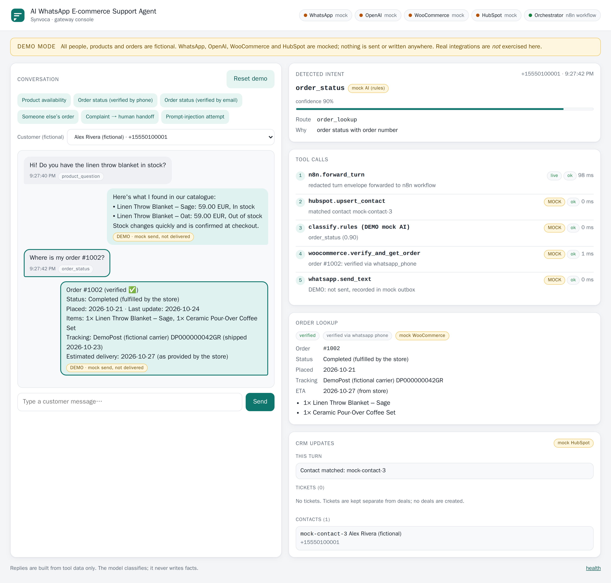
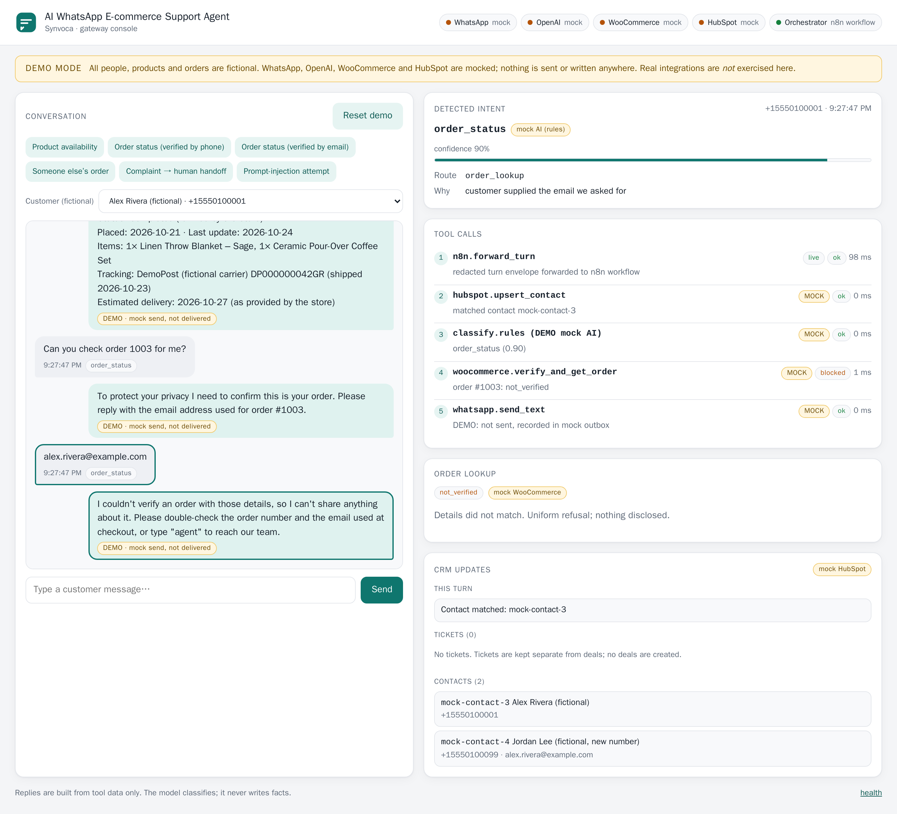
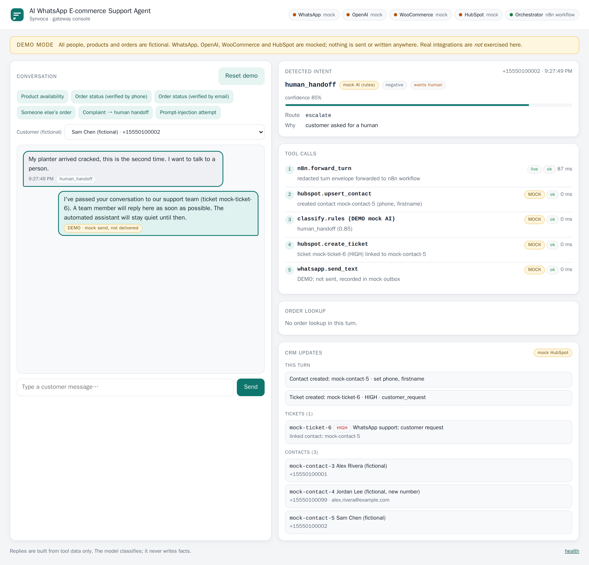
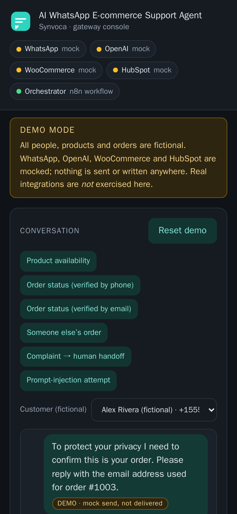

# AI WhatsApp E-commerce Support Agent


A production-minded WhatsApp support agent for online stores, built by **Synvoca**. It connects **Meta WhatsApp Cloud API → n8n → OpenAI → WooCommerce + HubSpot** and replies on WhatsApp.

It answers product questions from the live catalogue, looks up real order status after **verifying the customer owns the order**, creates and updates HubSpot contacts, opens support **tickets**, and hands the chat to a human when needed.

> **It never fabricates.** The model only *classifies* the message. Every reply is built from tool data, so stock levels, order statuses and delivery dates come from the store or are reported as unavailable.
>
> **Order details are never shown just because someone knows an order number.** Ownership is verified first.

---

## Contents

- [Architecture](#architecture)
- [Screenshots](#screenshots)
- [What's in the box](#whats-in-the-box)
- [Prerequisites](#prerequisites)
- [Installation](#installation)
- [Run the demo (no credentials)](#run-the-demo-no-credentials)
- [Run with n8n](#run-with-n8n)
- [Environment configuration](#environment-configuration)
- [Going live](#going-live)
- [Tests](#tests)
- [Security and privacy](#security-and-privacy)
- [Limitations](#limitations)
- [2-minute Upwork demo script](#2-minute-upwork-demo-script)

---

## Architecture



<sub>Source: [docs/architecture.mmd](docs/architecture.mmd) · PNG: [docs/architecture.png](docs/architecture.png) · re-render with `bash scripts/render-diagram.sh`</sub>

1. The **customer** writes on WhatsApp. **Meta** POSTs a signed webhook to the gateway.
2. The **Synvoca Gateway** (TypeScript, about 3.4k lines, one runtime dependency: zod) does the following:
   - answers Meta's verify-token challenge;
   - checks `X-Hub-Signature-256` on the raw body;
   - drops duplicate deliveries;
   - redacts PII, then forwards a minimal envelope plus a signed **turn token**.
3. The **n8n workflow** loads conversation context and asks **OpenAI** (Responses API, Structured Outputs, `store: false`) to classify the *redacted* text.
4. The gateway's **server guard** validates that classification and returns exactly one allowlisted route.
5. n8n calls the matching **tool** on the gateway:
   - WooCommerce product search;
   - order lookup with an ownership check;
   - HubSpot contact upsert;
   - HubSpot ticket + handoff.
6. The gateway sends the grounded reply through the WhatsApp Cloud API. It enforces the **24-hour window** and allows **one reply per message**.
7. **Escalation** creates a HubSpot ticket linked to the contact and mutes the bot until an agent releases it.

A **local orchestrator** in the gateway mirrors the workflow node by node, so the demo and the tests run without n8n.

## Screenshots

All data below is fictional. DEMO_MODE labels every mock.

| Order verified by WhatsApp number | Someone else's order: refused |
|---|---|
|  |  |
| **Complaint → HubSpot ticket + human handoff** | **Responsive, dark mode** |
|  |  |

The screenshots were captured with the gateway forwarding to a real n8n 2.20.12 instance running the workflow in this repo (`scripts/screenshots.sh`).

## What's in the box

| Path | What |
|---|---|
| [`n8n/whatsapp-ecommerce-agent.workflow.json`](n8n/whatsapp-ecommerce-agent.workflow.json) | Importable n8n workflow (23 nodes): context, classification, server guard, tools, reply, logging, bounded retries, error branch, handoff |
| [`src/`](src/) | Gateway: webhook verification and signatures, dedupe, redaction, allowlisted tool API, WooCommerce/HubSpot/WhatsApp/OpenAI clients, local orchestrator |
| [`public/`](public/) | Demo console (vanilla JS, strict CSP) |
| [`tests/`](tests/) | 102 Vitest tests + Meta/OpenAI payload [fixtures](tests/fixtures/) |
| [`docs/credentials.md`](docs/credentials.md) | Step-by-step credentials and **minimum scopes** for Meta, OpenAI, HubSpot, WooCommerce, n8n |
| [`docs/security-and-privacy.md`](docs/security-and-privacy.md) | Threat model, PII flows, retention, GDPR, WhatsApp policy |
| [`docs/n8n.md`](docs/n8n.md) | Workflow map and import steps |
| [`docs/manual-test-procedures.md`](docs/manual-test-procedures.md) | Go-live test plan for the live integrations |

## Prerequisites

- **Node.js 20.12+** (22 LTS recommended) and npm, **or** Docker (Compose v2.24+).
- For live mode only: a Meta developer app with WhatsApp, an OpenAI API key, a HubSpot private app, a WooCommerce store with REST API keys, and a public HTTPS URL for the webhook. See [docs/credentials.md](docs/credentials.md).

## Installation

```bash
git clone <this repo> ai-whatsapp-ecommerce-agent
cd ai-whatsapp-ecommerce-agent
npm ci
cp .env.example .env      # DEMO_MODE=true by default; no secrets needed for the demo
```

## Run the demo (no credentials)

```bash
npm run demo              # → http://localhost:3000
```

Or with Docker: `docker compose up --build`.

Click the scenario buttons, or type as one of the fictional customers:

| Scenario | What it shows |
|---|---|
| Product availability | Stock and price come from the (mock) catalogue; out-of-stock is reported honestly |
| Order status (verified by phone) | WhatsApp number = billing phone → status, items, tracking, store-provided ETA |
| Order status (verified by email) | Unknown number → asks for the order email → verified → CRM contact enriched |
| Someone else's order | Wrong email → uniform refusal, nothing disclosed |
| Complaint → human handoff | HIGH-priority HubSpot ticket linked to the contact; bot goes silent |
| Prompt-injection attempt | Classified out of scope; no data tools run |

You can also send a **signed** Meta-style webhook from another terminal, which exercises the exact production path:

```bash
npm run simulate -- --from 15550100001 --text "Where is my order #1002?"
npm run simulate -- --bad-signature        # → HTTP 401
```

**What DEMO_MODE is:** fictional people, products and orders, a rule-based "mock AI" classifier, mock WooCommerce, mock HubSpot and a mock WhatsApp outbox. Nothing leaves your machine, and the UI and API mark every mock (`mock: true`, `DEMO · mock send, not delivered`). **DEMO_MODE does not test the real integrations.**

## Run with n8n

```bash
ORCHESTRATOR=n8n docker compose --profile n8n up -d --build
docker compose exec n8n n8n import:credentials --input=/import/demo-credentials.json
docker compose exec n8n n8n import:workflow   --input=/import/whatsapp-ecommerce-agent.workflow.json
docker compose exec n8n n8n publish:workflow  --id=synvocaWaAgent01
docker compose restart n8n
```

Open the console at http://localhost:3000. Each turn now starts with `n8n.forward_turn`, and n8n's editor is at http://localhost:5678. If port 5678 is taken, prefix the first command with `N8N_HOST_PORT=5680`.

To import manually into an existing n8n (UI → *Import from File*), create the three credentials, set the tools base URL and the model, and publish. The step-by-step guide is in [docs/n8n.md](docs/n8n.md).

## Environment configuration

Every variable is documented in [`.env.example`](.env.example). The most important ones:

| Variable | Purpose |
|---|---|
| `DEMO_MODE` | `true` = mocks + fictional data. `false` = live; startup **fails** if any credential is missing, too short, or a placeholder |
| `ORCHESTRATOR` | `local` (gateway runs the flow) or `n8n` (gateway forwards to the workflow) |
| `META_APP_SECRET`, `META_VERIFY_TOKEN` | Webhook signature check and challenge |
| `WHATSAPP_ACCESS_TOKEN`, `WHATSAPP_PHONE_NUMBER_ID`, `GRAPH_API_VERSION` | Sending replies |
| `OPENAI_API_KEY`, `OPENAI_MODEL` | Intent classification |
| `HUBSPOT_ACCESS_TOKEN`, `HUBSPOT_TICKET_PIPELINE/STAGE` | Contacts + tickets |
| `WOOCOMMERCE_BASE_URL`, `WOOCOMMERCE_CONSUMER_KEY/SECRET` | Products + orders (read-only key, https only) |
| `TOOLS_API_TOKEN`, `TURN_TOKEN_SECRET`, `ADMIN_TOKEN`, `N8N_GATEWAY_TOKEN` | Internal secrets (`openssl rand -hex 32`) |
| `CONVERSATION_RETENTION_HOURS`, `ORDER_VERIFICATION_MAX_FAILURES`, … | Retention and abuse limits |

## Going live

1. Create credentials with minimum scopes: [docs/credentials.md](docs/credentials.md).
2. Fill `.env`, set `DEMO_MODE=false`, then `npm run build && npm start` (or `docker compose up -d --build`).
3. Expose **only** `/webhook` publicly over HTTPS. Keep `/tools`, `/api` and n8n private.
4. Register the webhook in Meta and subscribe to `messages`.
5. Work through [docs/manual-test-procedures.md](docs/manual-test-procedures.md) and record the results.
6. In live mode, open the console as `https://<host>/#token=<ADMIN_TOKEN>`. It shows redacted text and masked numbers only.

## Tests

```bash
npm run lint && npm run typecheck && npm test && npm run build    # or: npm run check
```

102 tests in 10 files, all passing. Highlights:

| Area | File |
|---|---|
| Meta verify-token challenge (200 / 403 / 400, no reflection) | `tests/webhook-verification.test.ts` |
| `X-Hub-Signature-256` on real HTTP traffic: tampering, raw-bytes, wrong secret, 413 | `tests/signature.test.ts` |
| Duplicate deliveries (sequential + concurrent), one reply per message, retry semantics | `tests/idempotency.test.ts` |
| HubSpot contact de-dup under concurrency and index lag, no overwriting, no email-based takeover | `tests/contact-dedup.test.ts` |
| Order ownership: phone/email verification, uniform refusal, no enumeration oracle, lockout, hallucinated order numbers | `tests/order-ownership.test.ts` |
| Escalation: explicit request, complaint priority, low confidence, tool error, ticket failure, mute and release, redacted ticket body | `tests/escalation.test.ts` |
| Tool API: auth, turn-token binding, strict schemas, redacted n8n envelope | `tests/tools-api.test.ts` |
| n8n workflow: generator drift, graph integrity, acyclic, bounded retries, no secrets, **Code nodes executed** | `tests/n8n-workflow.test.ts` |
| 24 h window, templates, no unsolicited messages, PII redaction, logging | `tests/window-and-privacy.test.ts` |
| Bounded retries, OpenAI Responses parsing/fallback, exact WooCommerce/HubSpot/Graph requests, config fail-fast | `tests/integrations.test.ts` |

## Security and privacy

Summary only. The full details are in [docs/security-and-privacy.md](docs/security-and-privacy.md).

- **Signatures:** HMAC-SHA256 over the raw body, constant-time compare, and an anti-reflection guard on the verify challenge.
- **Least privilege:** n8n holds no Meta, HubSpot or WooCommerce credentials. Every tool call needs a bearer token **and** a gateway-signed turn token that fixes which customer the call is for.
- **Untrusted input everywhere:** customer text, LLM output and upstream API data are all schema-validated and sanitised. The LLM has no tools and writes no replies.
- **PII minimisation:**
  - n8n and OpenAI see redacted text only, and OpenAI is called with `store: false`;
  - logs mask numbers and record message length only;
  - state expires after 72 h.
- **WhatsApp rules:**
  - free-form replies only inside the 24-hour window;
  - templates only for agent follow-ups to customers who wrote first;
  - no broadcast path.
- **HubSpot tickets, never deals.**

## Limitations

- **Live integrations are untested here.** Meta, OpenAI, HubSpot and WooCommerce clients are unit-tested against the documented request formats, but have not been run against real accounts. Use [the manual test procedures](docs/manual-test-procedures.md).
- **Single instance.** State lives in an in-memory TTL store. For several replicas, implement `KeyValueStore` on Redis (the interface is async for this reason).
- **Text messages only.** Images, voice notes and other media get a polite "please type your question".
- **Redaction is pattern-based** (emails, long digit runs). It reduces risk but cannot catch every form of personal data, such as street addresses written in prose.
- **Order numbers are assumed to equal WooCommerce order IDs.** Tracking is read from the *Shipment Tracking* extension's meta. Other plugins need a small adapter ([credentials.md §4](docs/credentials.md#4-woocommerce-rest-api)).
- **Phone matching** compares international digits. Billing phones saved without a country code need `DEFAULT_COUNTRY_CALLING_CODE`, and some countries' WhatsApp IDs differ from E.164 (for example, legacy Mexican and Brazilian mobile formats). Email verification is the fallback.
- **English reply templates.** Classification is multilingual through OpenAI, but `replies.ts` would need localisation.
- **Human agents** answer in their own tool (HubSpot inbox or WhatsApp Business), then release the handoff via `POST /api/admin/handoff/release`. A two-way HubSpot ↔ WhatsApp inbox sync is out of scope.
- **API versions:** defaults are Graph `v23.0`, OpenAI Responses + `gpt-5-mini`, HubSpot CRM v3 and WooCommerce `wc/v3`. Items marked *(verify)* in the docs should be checked against provider changelogs at deployment time.

## 2-minute Upwork demo script

> Setup before recording: `docker compose up --build` (or `npm run demo`), open http://localhost:3000, click **Reset demo**. For the n8n version, use the [n8n commands](#run-with-n8n) and keep the n8n editor open in a second tab.

| Time | Show | Say |
|---|---|---|
| 0:00–0:15 | Architecture diagram in the README | "This is a WhatsApp support agent for e-commerce. Messages come from Meta's Cloud API into a small security gateway, n8n orchestrates, OpenAI classifies, and WooCommerce and HubSpot are the sources of truth." |
| 0:15–0:30 | Console, yellow banner | "Everything here runs in demo mode: fictional customers and orders, every integration mocked and labelled. Nothing is sent." |
| 0:30–0:50 | Click **Product availability** | "The customer asks about stock. The AI only decides that this is a product question. The answer, in stock or out of stock, comes straight from the catalogue." Point at the tool-call timeline. |
| 0:50–1:10 | Click **Order status (verified by phone)** | "Order status: the WhatsApp number matches the order's billing phone, so it's verified. Status, items, tracking. The delivery date is shown only because the store provided it; otherwise the bot says so instead of guessing." |
| 1:10–1:30 | Click **Someone else's order** | "Now the same customer asks about an order that isn't theirs. Knowing the number isn't enough. The bot asks for the order email, the email is wrong, and it refuses without revealing anything. Repeated failures lock lookups and alert a human." |
| 1:30–1:45 | Click **Complaint → human handoff**, point at CRM panel | "A complaint creates a HubSpot ticket, not a deal, linked to the contact, and the bot goes silent so a person takes over." |
| 1:45–2:00 | n8n editor tab, or the test summary | "The n8n workflow is importable, retries are bounded, and errors end in a single escalation. There are 102 automated tests covering signatures, duplicates, ownership and escalation, plus a go-live checklist for connecting your real accounts." |

---

<sub>Built by Synvoca. Demo data is fictional; WhatsApp, Meta, OpenAI, HubSpot, WooCommerce and n8n are trademarks of their respective owners. No affiliation is implied.</sub>
